# AURA — Agent Usage & Resource Analytics

A local-first analytics platform (Docker or native) for AI coding agent sessions (Claude Code today; Gemini, Codex, and friends on the roadmap). Aura watches your agent transcripts, transforms them through dbt, and surfaces cost, productivity, behavioural and pipeline-health signals through a Next.js dashboard. All data stays on your machine.

> *Spend, with receipts.*

**Built for the individual first.** You run Aura on your own machine, against your own transcripts; nothing is uploaded anywhere. **Designed for the team second:** the same pipeline is built so that each developer's *processed, privacy-masked* marts — never raw conversations — can be shipped to a central store and served through one team-wide dashboard. The schema (`tenant_id`, `person_id`) is already plumbed for it; see [From individual to team](#from-individual-to-team-central-rollout).

📖 **Documentation** — start here:
- [docs/screens/OVERVIEW.md](docs/screens/OVERVIEW.md) — operator's guide: when to open which screen, conventions, data lineage
- [docs/screens/HOW-IT-WORKS.md](docs/screens/HOW-IT-WORKS.md) — architecture deep-dive: watcher internals, dbt layers, agent attribution, failure modes
- [docs/screens/](docs/screens/) — 13 per-screen `.md` reference docs + screenshots

---

## Why Aura

If you use Claude Code, Cursor, Aider, or any agentic coding assistant, you are already producing a goldmine of structured data on how you and your team think, debug, and ship. Aura turns that exhaust into a usable record:

- **Cost transparency** — every dollar spent, broken down by model, agent, project, person, and individual prompt. Every page that shows a cost reconciles to the same total for the same time range.
- **Operator visibility** — who is using which agent, what they ask for, and what gets delivered
- **Quality signals** — overkill detection (used Opus for a one-liner?), error rates per agent, cache hit rates, time-to-completion
- **Replay** — every prompt and response, tool call by tool call, with attribution back to the file paths that were edited
- **Pipeline observability** — built-in `/observability` tab shows ingestion freshness, dbt run status, source-freshness checks, and watcher failures so you always know whether the numbers you're looking at are current

Designed for individuals who want introspection on their own AI usage, and for teams who want a shared, honest picture of agent ROI.

---

## Architecture

Three stages that never block each other: JSONL → Parquet lake (the watcher, every 30 s), lake → marts (dbt, every `AURA_DBT_RUN_INTERVAL_MINUTES`, default 5), marts → read DB (publish, right after each successful `dbt run`). The dashboard only ever opens a finished read DB.

```
┌────────────────────┐   ┌──────────────────────────┐   ┌────────────────────────────────┐
│  ~/.claude/        │──▶│  watcher (Python)        │──▶│  data/lake/  (Parquet, bronze) │
│  projects/*.jsonl  │   │  observer + sweep,       │   │  raw_events/date=…/part-*.parq │
│                    │   │  adapters, redaction,    │   │  raw_session_skills, …mcps,    │
│                    │   │  flush every 30 s,       │   │  session_meta, watcher_errors  │
│                    │   │  compaction              │   └───────────────┬────────────────┘
└────────────────────┘   │  checkpoints → SQLite    │                   │ read_parquet,
                         └────────────┬─────────────┘                   │ ingested_at <= cutoff
                                      │ dbt thread: cutoff → seed → run │
                                      ▼                                 ▼
                         ┌──────────────────────────────────────────────────────┐
                         │  data/work/aura.duckdb   (dbt work DB)               │
                         │  stg_* → int_* → dim_* / fact_*                      │
                         └────────────┬─────────────────────────────────────────┘
                                      │ publish: CREATE TABLE … AS SELECT
                                      │ (dashboard tables only, text capped)
                                      ▼
                         ┌──────────────────────────────────────────────────────┐
                         │  data/read/v<stamp>/aura.duckdb  + data/read/CURRENT │
                         └────────────┬─────────────────────────────────────────┘
                                      │ read-only, reopened when CURRENT changes
                                      ▼
                         ┌──────────────────────────────────────────────────────┐
                         │  Next.js 14 (App Router) — http://127.0.0.1:3000     │
                         │  also reads data/artifacts/ (dbt results, watcher    │
                         │  status, number checks) for /observability           │
                         └──────────────────────────────────────────────────────┘
```

All data lives in `data/<user>/`, where `<user>` is the OS username (`AURA_USER` overrides). Sessions are attributed to the same user unless `AURA_DEFAULT_PERSON_ID` is set.

| Surface | Language | Purpose |
|---|---|---|
| `watcher/` | Python 3.12, `watchdog`, DuckDB (for Parquet I/O) | Tail JSONL, redact secrets, flush rows to the Parquet lake, keep byte-offset checkpoints in SQLite, compact small files, run the dbt cycle and publish the read DB |
| `dbt/` | SQL, dbt-core 1.11 + dbt-duckdb 1.10 | Lake sources → staging → intermediate → marts in the work DB. Source freshness on `raw_events.ingested_at` (warn 5 min / error 30 min) |
| `frontend/` | Next.js 14 (App Router), TypeScript, `@duckdb/node-api` | Dashboard, per-entity pages and the live Observability tab, reading the published read DB |

See [docs/screens/HOW-IT-WORKS.md](docs/screens/HOW-IT-WORKS.md) for the details: flush and checkpoint order, compaction, the dbt cutoff, and the publish steps.

---

## What you get on the dashboard

| Page | What it shows |
|---|---|
| **Dashboard** (`/`) | Hero "Spend, with receipts." + 14-day cost, KPI strip (active sessions, cache hit rate, tool calls, commits, errors, 30-day projection), daily spend chart, apps ledger, projects rollup, agents table (now with app/project context), files, errors, tool mix, providers, models, cache split, loudest prompt of the day |
| **Apps** (`/apps`) | Every app you've worked in — cost, sessions, turns, commits, agents in rotation |
| **App detail** (`/apps/[appId]`) | Agents in this app, **People in this app**, sibling apps in the project, recent sessions, full chronological prompt feed |
| **Agents** (`/agents`) | Every agent × app row (same agent name in different apps shows separately) — sortable by cost, sessions, turns |
| **Agent detail** (`/agents/[name]`) | **People delegating** to this agent, apps served, models routed to, recent sessions, top files touched, prompts directed at this agent |
| **People** (`/people`) | Rich operator cards: cost, sessions, turns, commits, apps chips, agents chips, % of org spend |
| **Person detail** (`/people/[personId]`) | Agents this person delegates to, apps they work in, recent sessions, **"What {name} actually types"** prompt log |
| **Sessions** (`/sessions`) | Filterable ledger of every session with title, model, turns, cost, person, agent |
| **Session detail** (`/sessions/[id]`) | Per-turn ledger (the default Details view) with tabs for prompts, agents, errors, files, tokens, tools, git |
| **Errors** (`/errors`) | Hard errors, warnings, tool failures across all sessions with filters by kind/tool/severity |
| **Observability** (`/observability`) | Single consolidated pipeline view: derived verdict block, 5-stage flow strip (Watcher → Bronze → Silver → Gold → Consumers), medallion-layer cards with per-table rows / size / age, 4-column KPI grid, 1h/1d/7d ingestion sparklines, source freshness table, dbt test grid + per-relation breakdown, last 6 dbt invocations, live watcher errors feed, expandable `run_results.json` / `sources.json`. Polls every 10 s. |

---

## Project layout

```
AURA/
├── watcher/        Python package — JSONL adapters, Parquet lake writer, checkpoints, compaction, dbt cycle + publish
├── dbt/            dbt project — staging → intermediate → marts, model_pricing seed
├── frontend/       Next.js 14 app — dashboard, per-entity pages, Observability tab
├── docs/           Architecture deep-dive, per-screen docs, number map, blog
├── scripts/verify/ Number checks run after every dbt cycle (run_all.mjs)
├── docker-compose.yml, start.ps1, start.sh   Run modes
└── .claude/        Agent definitions (runner, data-engineer, dbt-expert, frontend-engineer)
```

`watcher/`, `dbt/`, and `frontend/` are the three independent surfaces. Changes to one rarely need to touch the others — see the surface map in [CLAUDE.md](CLAUDE.md) for routing guidance.

---

## Tech stack

- **Ingestion:** Python 3.12, `watchdog` (polling observer in Docker, OS observer natively), DuckDB's Python client for writing Parquet
- **Storage:** an append-only Parquet lake (`data/<user>/lake/`, Hive `date=` partitions, zstd) plus a SQLite file for checkpoints (`data/<user>/state/aura_state.sqlite`)
- **Transform:** dbt 1.11 with `dbt-duckdb`, building into a DuckDB work DB (`data/<user>/work/aura.duckdb`). `run_results.json`, `manifest.json` and `sources.json` are copied to `data/<user>/artifacts/` after every cycle
- **Serving:** a small read DB per publish (`data/<user>/read/v<stamp>/aura.duckdb`), holding only the tables and columns the dashboard queries (`watcher/src/aura_watcher/read_tables.sql`)
- **Pricing:** SCD-style `model_pricing` seed (per-tenant overrides supported)
- **Frontend:** Next.js 14 App Router, TypeScript, server components reading DuckDB directly through `lib/db.ts`, which follows `data/<user>/read/CURRENT`
- **Run modes:** Docker Compose (two services sharing `./data`) or native (`start.ps1` / `start.sh`)

---

## Quick start (Docker)

**Requirements:** Docker, Docker Compose, and an existing `~/.claude/projects/` directory with at least one session.

```bash
git clone https://github.com/<you>/AURA.git
cd AURA
cp .env.example .env   # set your identity vars — defaults work out of the box
docker compose up --build
```

Then open `http://127.0.0.1:3000` (the port is bound to localhost only).

On first boot the watcher:

1. Refuses to start if a native watcher wrote its status in the last 120 s (see [Run modes](#run-modes)).
2. Deletes leftover `*.tmp` lake files and DuckDB spill files from an unclean shutdown, and creates an empty schema file per lake table.
3. Starts the dbt thread: the first cycle runs immediately on whatever is in the lake, then every 5 minutes. It does not wait for the backfill.
4. Sweeps every `.jsonl` under `AURA_LOGS_DIR`, oldest first. This is the backfill: about 28 minutes for 6 GB of transcripts. Byte offsets are checkpointed after each flush, so a restart resumes where it stopped.
5. Keeps watching for new bytes (observer + periodic sweep).

**Freshness:** a new event reaches the dashboard after poll (30 s) + flush (30 s) + the wait for the next dbt cycle (≤ 5 min) + the cycle and publish time. The target is a median under 5 minutes; `/observability` shows the age of every layer, and `data/<user>/artifacts/freshness.ndjson` records the measured lag per publish.

---

## Run modes

| | Docker Compose | Native, Windows | Native, Linux/macOS |
|---|---|---|---|
| Start | `docker compose up --build` | `.\start.ps1` (`-Rebuild` forces a frontend build and `pip install`) | `./start.sh` (`--rebuild`) |
| Stop | `docker compose down` | Ctrl+C or `.\start.ps1 -Stop` | Ctrl+C or `./start.sh stop` |
| Observer | polling, every 30 s; sweep every 600 s | OS observer; sweep every 60 s | OS observer; sweep every 60 s |
| Data dir | `./data` mounted at `/data` | `<repo>/data` | `<repo>/data` |
| Logs | `docker compose logs` | `data/<user>/logs/watcher.log`, `frontend.log` (stderr in `*.err.log`) | `data/<user>/logs/watcher.log`, `frontend.log` |
| Status | tested | tested | **untested** (written on Windows, checked with `bash -n` only); compose is the supported Linux/macOS path |

The native scripts need **Python 3.12** (the pinned dbt-duckdb/duckdb wheels) and **Node ≥ 20**. They create `.venv` at the repo root (watcher and dbt in one venv), build the frontend's standalone server, set the env vars below and start the watcher and the frontend. They do not read `.env`: set `AURA_USER` or `AURA_DEFAULT_PERSON_*` in your shell to override the OS username.

**Never run both modes at once.** Both write the same lake, state DB and work DB. The watcher enforces it: if `data/<user>/artifacts/watcher_status.json` was written less than 120 s ago by the other mode, it prints which mode and host is running and exits with code 2. After a switch, the first dbt cycle always runs. File paths are stored as logical paths (`claude/<project>/<session>.jsonl`), so a switch does not re-read every file.

**Stopping:** `start.ps1` stops with `taskkill /T /F` (a hard kill, so no orphan `dbt.exe` keeps the work DB locked). Up to 30 s of buffered rows are not flushed; they are re-read on the next start (at-least-once, duplicates removed in dbt, no loss). `start.sh` and `docker compose down` send SIGTERM, and the watcher flushes before it exits.

### First-time migration from the old single-DuckDB layout

If you ran Aura before the lake layout, `data/aura.duckdb` holds history whose source JSONL files Claude Code has already deleted (30-day cleanup). Copy it into the lake once, with Docker stopped:

```bash
.venv/Scripts/python -m aura_watcher.export_legacy --src data/aura.duckdb --data-dir data/<user>   # Linux/macOS: .venv/bin/python
.venv/Scripts/python -m aura_watcher.main --once --with-dbt
```

The export opens the old file read-only, redacts payloads with the current rules, verifies row counts and uuid sets in a staging dir before it touches the lake, and writes `data/<user>/artifacts/export_legacy.json` (counts, `redacted`, `invalid_json`). Check it before you continue. The `--once` run then backfills the files still on disk and does the first full dbt build. Keep `data/aura.duckdb` as a backup; the new code never reads it.

### Environment variables

Paths default to locations under `AURA_DATA_DIR`; set them only to move one piece. Use absolute, forward-slash paths.

| Variable | Default | What it does |
|---|---|---|
| `AURA_DATA_DIR` | `/data` (scripts: `<repo>/data`) | Root of the lake, state, work, read, inbox, artifacts and logs dirs |
| `AURA_RUN_MODE` | `compose` / `native`; unset = `unknown` | Written to the status file; the mode guard compares it |
| `AURA_LAKE_DIR` | `$AURA_DATA_DIR/lake` | Parquet lake (watcher writes, dbt reads) |
| `AURA_STATE_DB` | `$AURA_DATA_DIR/state/aura_state.sqlite` | Checkpoints, file stats, meta (watcher only) |
| `AURA_DB_PATH` | `$AURA_DATA_DIR/work/aura.duckdb` | dbt work DB. The basename must stay `aura.duckdb` (dbt bakes the catalog name into views) |
| `AURA_READ_DIR` | `$AURA_DATA_DIR/read` | Published read DBs and the `CURRENT` pointer (frontend, `run_all.mjs`) |
| `AURA_ARTIFACTS_DIR` | `$AURA_DATA_DIR/artifacts` | dbt artifacts, `watcher_status.json`, `publish.ndjson`, `freshness.ndjson`, `number_verify.json` |
| `AURA_VERDICTS_INBOX` | `$AURA_DATA_DIR/inbox/verdicts-inbox.jsonl` | Frontend appends verdicts, dbt reads them |
| `AURA_LOGS_DIR` | `/logs/claude` (scripts: `~/.claude/projects`) | Where the watcher looks for `.jsonl` files |
| `CLAUDE_LOGS_DIR` | `~/.claude/projects` | Compose only: host path mounted at `/logs/claude` |
| `AURA_EXTRA_TRACE_DIRS` | empty | Comma-separated extra dirs with Agent SDK traces |
| `AURA_OBSERVER` | `polling` (scripts: `native`) | File observer type |
| `AURA_POLL_SECONDS` | `30` | Polling observer interval |
| `AURA_SWEEP_INTERVAL_SECONDS` | `600` (scripts: `60`) | Full re-scan for bytes the observer missed |
| `AURA_FLUSH_SECONDS` | `30` | Lake flush interval |
| `AURA_FLUSH_MAX_ROWS` | `20000` | Flush early when the buffer reaches this many rows |
| `AURA_COMPACT_MIN_FILES` | `50` | Compact today's partition once it has this many files (past days: ≥ 2) |
| `AURA_COVERAGE_INTERVAL` | `300` | Seconds between ingest coverage reports |
| `AURA_DBT_RUN_INTERVAL_MINUTES` | `5` | dbt cycle interval, start to start |
| `AURA_DBT_TIMEOUT_SECONDS` | `1800` | Timeout per dbt command |
| `AURA_DBT_DIR` | `/app/dbt` (scripts: `<repo>/dbt`) | dbt project dir |
| `AURA_VERIFY_SCRIPT` | `/app/scripts/verify/run_all.mjs` | Number checks run after each cycle (skipped without `node`) |
| `AURA_DBT_THREADS` / `AURA_DBT_DUCKDB_THREADS` | `2` / `2` in compose | Models built concurrently / DuckDB threads per query |
| `AURA_DBT_MEMORY_LIMIT` | `4000MB` in compose | DuckDB memory ceiling for dbt. Keep it ~1 GB below the container `mem_limit` so DuckDB spills instead of being OOM-killed |
| `AURA_REDACT_PAYLOAD` | `true` | Set to `false` to store payloads without secret redaction |
| `AURA_HASH_CONTENT` | empty (off) | `1`/`true` hashes conversational text at ingest — see [Privacy](#privacy-column-masking-before-anything-leaves-the-machine) |
| `AURA_MODEL_WINDOWS_JSON` | `{}` | Override model context window sizes, e.g. `{"new-model-id":1000000}` |
| `AURA_DEFAULT_PERSON_ID` / `AURA_DEFAULT_PERSON_NAME` | `local` / `Local User` in compose | Who the sessions belong to (the container user is `root`) |
| `AURA_QUERY_TIMEOUT_MS` | `15000` | Frontend: max time for one DuckDB query |
| `AURA_DUCKDB_THREADS` / `AURA_DUCKDB_MEMORY_LIMIT` | `4` / `1GB` | Frontend DuckDB threads and memory (compose `mem_limit` is 1536m) |

Removed: `AURA_READ_DB_PATH`, `AURA_SNAPSHOT_INTERVAL`, `AURA_BACKFILL_BATCH_SIZE`, `AURA_BACKFILL_BATCH_SECONDS`.

### Developing one surface by hand

Run dbt against the current lake from `dbt/` in the `.venv`, with absolute paths and an existing inbox file:

```bash
export AURA_DB_PATH="$PWD/../data/<user>/work/aura.duckdb" AURA_LAKE_DIR="$PWD/../data/<user>/lake" \
       AURA_VERDICTS_INBOX="$PWD/../data/<user>/inbox/verdicts-inbox.jsonl" TZ=UTC
dbt run --profiles-dir . --no-partial-parse
```

Stop the watcher first: only one process may open the work DB for writing. For the frontend, `cd frontend && npm run dev` with `AURA_DATA_DIR` pointing at a data dir that has a published read DB.

---

## Configuring people

By default, every session is attributed to the host OS user (`getpass.getuser()` natively; compose passes the host username in). To make the People page meaningful with friendly display names, create `~/.aura/people.json`:

```json
{
  "alice": { "name": "Alice Liu", "role": "Founding engineer" },
  "bob":   { "name": "Bob Chen",  "role": "Designer" }
}
```

Keys are OS usernames; values flow into `session_meta` at ingestion time.

---

## Screenshots

Captured against the live local stack. Every shot below is the
above-the-fold viewport (1440×900) — the first screen you see on each
page, not a full-page scroll capture.
For per-screen documentation see [docs/screens/](docs/screens/) — start
with [OVERVIEW.md](docs/screens/OVERVIEW.md) for navigation and
[HOW-IT-WORKS.md](docs/screens/HOW-IT-WORKS.md) for architecture.

### Dashboard
Single summary screen — cost, token volume, ledgers for apps/projects/agents,
heatmap, side panels, and Skills & MCPs at the bottom.

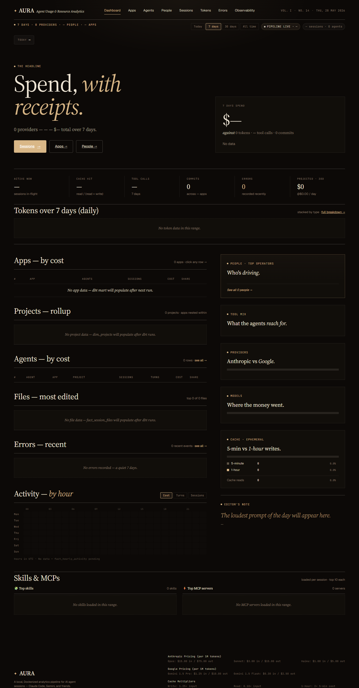

### Tokens drill-down
Token spend broken down by type, provider, model, and agent. Hourly
buckets on `range=today`, daily otherwise. Distinct colour palette per
token type (teal/gold/orange/violet/slate).

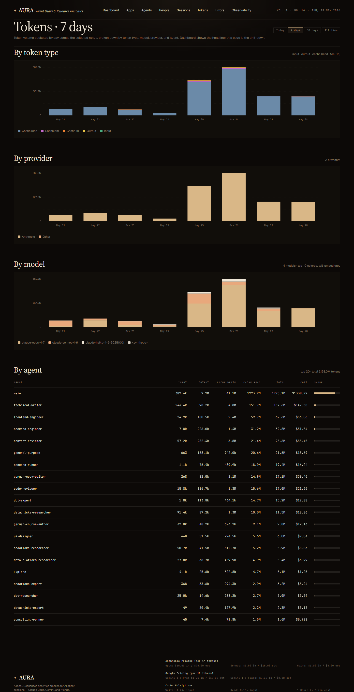

### Sessions list & Session detail
Filterable ledger of every session with 🧩 (skills) + ⚡ (MCPs) count
columns and multi-agent rendering; then a per-session deep-dive — the
detail shot below is the default **Details** view (per-turn ledger and
stat cards) that opens when you click a session.

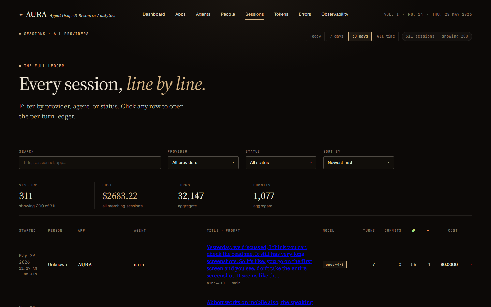
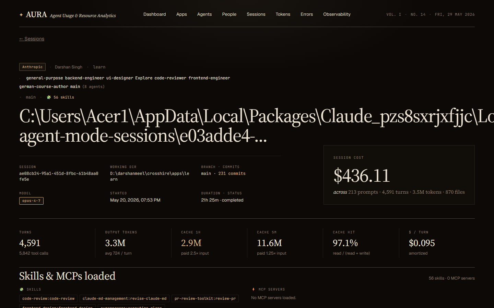

### Apps & App detail
Card grid by cost; per-app rollup with sessions, agents, people, sibling
apps, prompt feed, and a "Skills & MCPs in this app" panel.

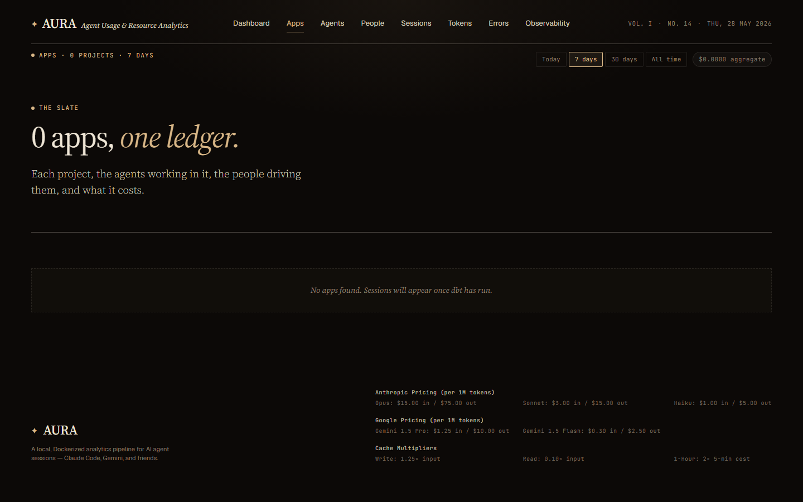
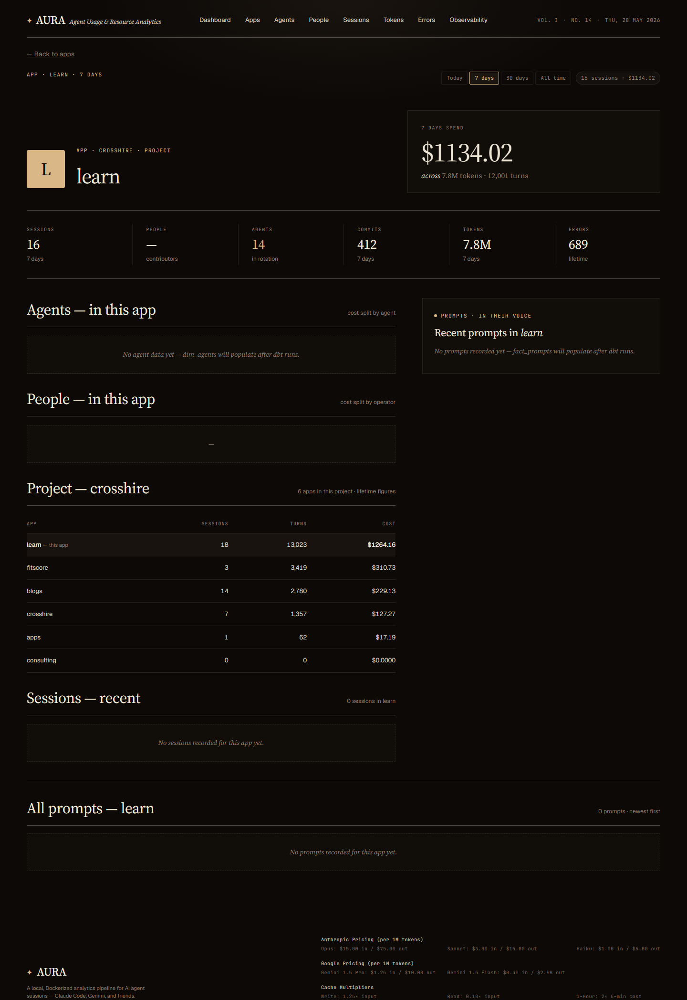

### Agents & Agent detail
Subagent roster with **real attribution** (technical-writer, frontend-engineer,
code-reviewer, …) — `fact_model_calls.agent` now joins
`int_event_agent.agent_resolved` so spend no longer lumps under one
`claude` row. Footnote on the list explains the `main` bucket.

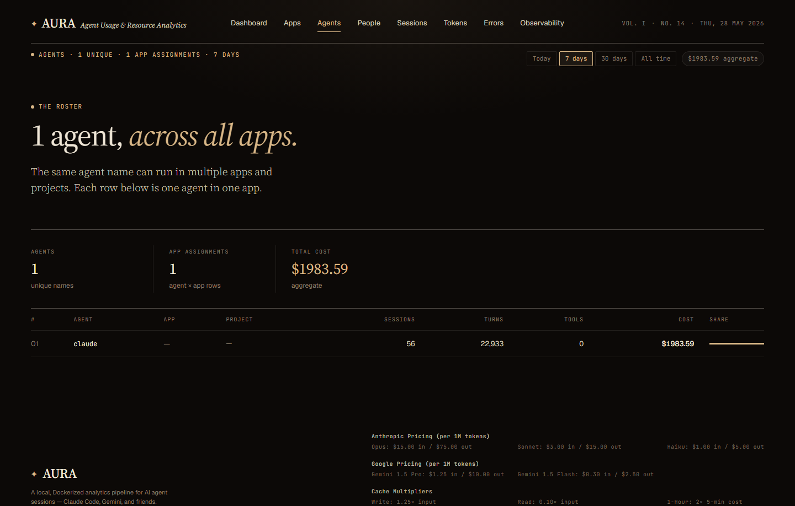
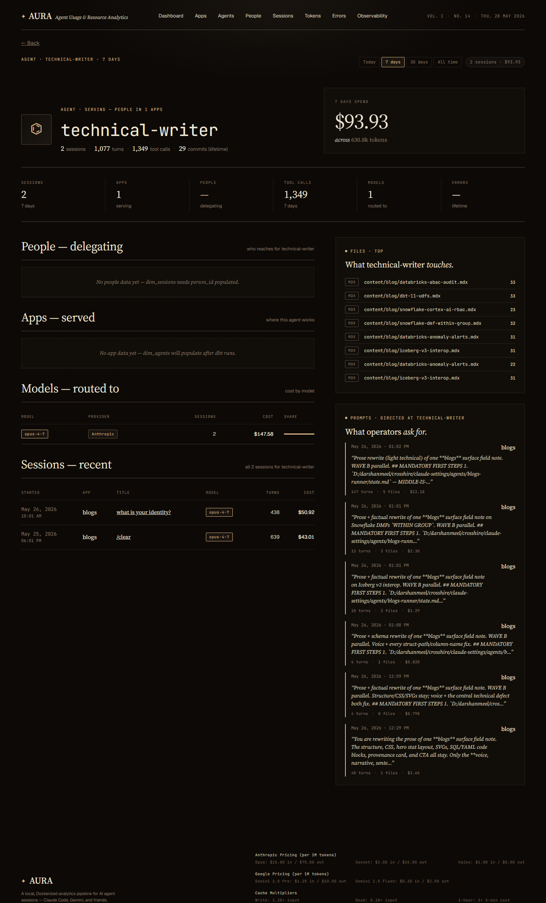

### People & Person detail
Operator roster with real names (311 / 349 sessions resolve to the
configured `AURA_DEFAULT_PERSON_*`); per-person profile with agents
delegated to, apps worked in, and the operator's prompt log.

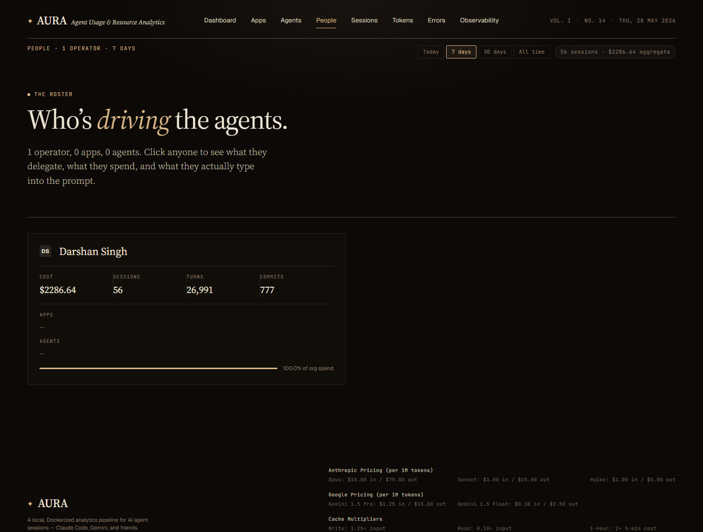
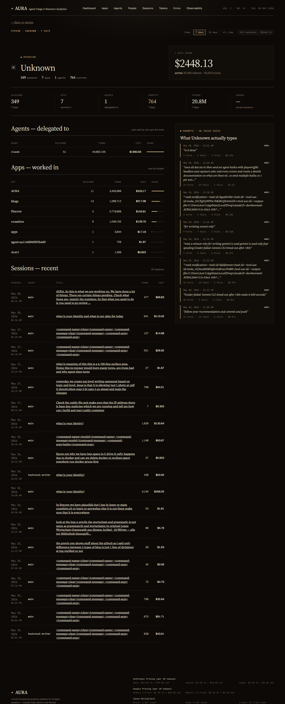

### Errors
Hard errors, warnings, and tool failures from `fact_errors`, filterable
by kind and tool. Timestamps now carry date + time (e.g. `May 28 ·
09:57:26`).

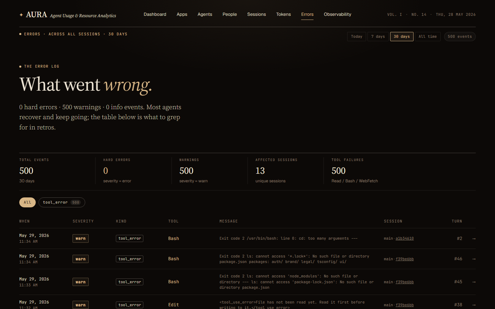

### Observability
Pipeline health at a glance — verdict, flow strip, medallion layer ages,
KPI grid, ingestion volume, source freshness, dbt tests, recent watcher
errors. Polls every 10 s via `/api/observability`.

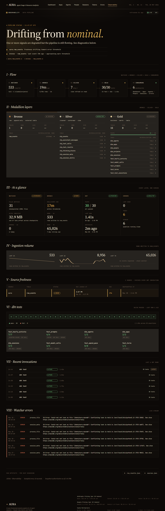

---

## Notable behaviour

- **Pricing is SCD-aware.** The `model_pricing` seed has `valid_from` / `valid_to` columns; cost calculation joins on the timestamp of the model call, so historical sessions stay correctly priced even when rates change.
- **Cost is anchored to event timestamp, never session-start.** All cost aggregations derive from `fact_model_calls.calculated_cost` filtered by `CAST(ts AS DATE)`. Session-start (`dim_sessions.start_ts`) is used only for counting sessions and behavioural metrics. The formula behind every displayed number is in [docs/number-map.md](docs/number-map.md).
- **Cost reconciles across all pages.** `int_entity_spend` pre-aggregates `fact_model_calls` to `(date × app/agent/person)` grain, and every range-filtered cost reads it. The dashboard total equals the sum of app, agent and person costs for the same range. A dbt test (`cost_reconciliation`) and `scripts/verify/run_all.mjs` check this after every cycle.
- **Cache hit rate uses the right denominator.** `cache_read / (cache_read + cache_write_5m + cache_write_1h)` — not `cache_read / input_tokens`.
- **Agents are tracked per app**, not just by name. `runner` in your Aura project and `runner` in another project show up as separate rows.
- **Overkill detection.** `fact_prompts` scores each external prompt on a complexity tier (S/M/L/XL by char count, tool calls, files edited) and compares it to the model tier (Haiku/Sonnet/Pro/Opus). If you used Opus to fix a typo, the prompt gets flagged.
- **Sidechain agent attribution.** Subagent transcripts carry their agent id in the file name; `int_event_agent` matches it to the Task/Agent dispatch, so subagent spend shows under the subagent in `dim_agents` and `fact_prompts`.
- **Ingestion is at-least-once and never blocked.** The watcher writes Parquet files first and commits checkpoints second; dbt drops duplicates on `(tenant_id, uuid)`. No dbt cycle, compaction or dashboard query can make ingestion wait.
- **The dashboard never sees a half-built DB.** Each publish goes to a new version directory and `CURRENT` is switched with an atomic replace; a failed publish leaves the old version live.
- **Watcher failures are persisted.** Parse and write errors become `watcher_errors` rows in the lake (with traceback), and the Observability page lists them.

---

## Troubleshooting

- **"another Aura watcher (… ) is running" and exit code 2.** The other run mode is up, or stopped less than 120 s ago. Stop it (`docker compose down`, `.\start.ps1 -Stop`, `./start.sh stop`) or wait.
- **Dashboard says "read DB not published yet".** No dbt cycle has published since the data dir was created. Watch `/observability` or the watcher log; the first cycle starts at watcher startup.
- **Numbers stop advancing.** Check the dbt status on `/observability`. A failed or timed-out cycle keeps the old read DB live; the error is in the watcher log and `data/<user>/artifacts/watcher_status.json`.
- **Out of memory during dbt.** `AURA_DBT_MEMORY_LIMIT` is a soft DuckDB ceiling; keep it about 1 GB below the container `mem_limit`. If a model still fails, lower `AURA_DBT_THREADS` and/or `AURA_DBT_DUCKDB_THREADS` before raising the ceiling. Two signatures:
  1. `Out of Memory ... 16383.9 PiB used` — not real exhaustion; orphaned spill files in `data/<user>/work/aura.duckdb.tmp/` from an unclean shutdown. The watcher purges them at startup; delete the dir yourself if you see this after a manual kill.
  2. A sane figure such as `3.7 GiB/3.7 GiB used` — real exhaustion: raise the ceiling (within the headroom rule) or lower the thread knobs.
- **`docker compose stop` hangs.** The watcher service needs `init: true` (it reaps the dbt child); confirm it is still in `docker-compose.yml`.
- **Extra `data/<user>/read/v*` dirs on Windows.** A version the frontend still has open cannot be deleted; a later cycle removes it.

---

## Performance & materialization strategy

The heavy models are incremental: `fact_prompts`, `fact_tool_executions`, `stg_tool_results` and `dim_turn_messages` rebuild only the sessions that received lake rows since the previous build (`recent_sessions()` macro, cursor = the previous cycle's cutoff, since `raw_events.ts` is event time and not a safe cursor). Everything else is a `table` or `view` rebuilt each cycle. When nothing changed in the lake, the inbox or the dbt project, the cycle is skipped (at most for 60 minutes).

**Known limit: a `fact_prompts` full refresh needs the full 4 GB pool.** Routine incremental cycles fit easily, but a full rebuild (first boot, a deleted work DB, or `--full-refresh`) exhausted a 3 GB pool in testing. Don't lower `AURA_DBT_MEMORY_LIMIT` below 4 GB if a full refresh may run.

**The read DB stays small.** Publish copies only the tables and columns the dashboard queries. Payload JSON and tool output are not copied; prompts and replies are capped at 20,000 characters. Full text stays in the lake and the work DB. Each publish records its size in `data/<user>/artifacts/publish.ndjson`.

**Work DB growth.** DuckDB files do not shrink. If `data/<user>/work/aura.duckdb` grows far beyond its data, stop Aura and delete it; the next cycle rebuilds everything from the lake.

Dimensions that derive from facts (`dim_sessions`, `dim_apps`, `dim_agents`, `dim_people`) stay `table`: they are cheap to rebuild, and incremental dimensions drift when a fact changes after the fact.

---

## From individual to team (central rollout)

Aura is deliberately **hub-and-spoke**, not SaaS. Every developer keeps running the full local stack (watcher → Parquet lake → dbt → dashboard) exactly as described above — full detail, fully private. Team visibility is an *export* problem, not a hosting problem: each machine periodically ships its **processed, masked marts** — never raw transcripts — to a central store, and one shared dashboard reads the union.

```
   dev laptop A                dev laptop B                dev laptop C
┌─────────────────┐        ┌─────────────────┐        ┌─────────────────┐
│  Aura (local)   │        │  Aura (local)   │        │  Aura (local)   │
│  full detail,   │        │  full detail,   │        │  full detail,   │
│  private :3000  │        │  private :3000  │        │  private :3000  │
└────────┬────────┘        └────────┬────────┘        └────────┬────────┘
         │    processed marts only — masked, no raw transcripts │
         └──────────────────────────┬───────────────────────────┘
                                    ▼
              central store (MotherDuck / S3 + DuckDB /
                Postgres / any dbt-supported warehouse)
                    rows keyed by tenant_id + person_id
                                    │
                                    ▼
              one team dashboard — the same Next.js app,
              pointed at the central DB (read-only, SSO'd)
```

**What leaves each machine:** the gold-layer marts (`fact_daily_spend`, `fact_model_calls`, `dim_sessions`, `fact_prompts`, …) with every sensitive text column masked (table below). `raw_events` and the JSONL transcripts never leave.

**What's already plumbed for this:**
- every table carries `tenant_id` (always `'local'` today) — set it per developer/machine and central rows never collide;
- `session_meta.person_id` / `person_name` attribute every session to a person (`~/.aura/people.json`);
- the `model_pricing` seed supports per-tenant overrides;
- the dbt project is warehouse-portable — swap the `dbt-duckdb` adapter for Snowflake/BigQuery/MotherDuck and the models carry over;
- the frontend is a read-only consumer of one DuckDB path — pointing it at a central replica is configuration, not surgery.

**What's still to build** *(status: designed, not yet implemented)*: the exporter itself (a small job that pushes masked marts on an interval), central-side dedup on `(tenant_id, natural key)`, and auth/RBAC on the shared dashboard.

### Privacy: column masking before anything leaves the machine

When rolling out to multiple users, it's critical to preserve privacy. **Before any data is shipped to a central server, message and prompt content will be masked so that only the individual user can see their own conversations — not other users, not managers, not admins.**

The following columns contain sensitive content and will be masked or hashed prior to central ingestion:

| Column | Location | Masking approach |
|---|---|---|
| `user_prompt` | `int_turns`, `dim_turn_messages` | SHA-256 hash (content not recoverable) |
| `assistant_response` | `int_turns`, `dim_turn_messages` | SHA-256 hash (content not recoverable) |
| `prompt_text_200` | `fact_prompts` | Masked / nulled out |
| `summary_200` | `fact_prompts` | Masked / nulled out |

**How it works:**
- The log-shipper (or a pre-ship dbt macro) replaces raw text in these columns with a cryptographic hash (SHA-256) before the data leaves the user's machine.
- All other columns — token counts, costs, tool names, timestamps, model IDs — travel unmasked and are safe to aggregate across users.
- A user viewing their own session detail page sees the full decrypted content sourced directly from their local DuckDB, not from the central copy.
- The central warehouse only ever receives hashed values, so even a compromised central store cannot reveal what any developer typed.

> **T8 (implemented, 2026-07-16): local hash mode.** `watcher/src/aura_watcher/redact.py` now implements the ingest-time half of this — `hash_message_content()`, gated behind the `AURA_HASH_CONTENT` env var (default **off**; see the env-var table above). When enabled (`1` or `true`), the watcher replaces `$.message.content` and `$.message.content[N].text` with `sha256:<hex>` markers **at ingest time**, before the line is written to `raw_events.payload` — the single source all four columns (`user_prompt`, `assistant_response`, `prompt_text_200`, `summary_200`) are derived from downstream in dbt. Hashing runs *after* secret redaction (`AURA_REDACT_PAYLOAD`), so a leaked credential is redacted first and the redacted text is what gets hashed. This makes those four columns cryptographically non-recoverable for any row ingested while the flag is on.
>
> **Applies to new ingests only** — turning the flag on does not retroactively rewrite rows already sitting in `raw_events`; only bytes read after the flag is set are hashed. Turning it off later does not un-hash them either.
>
> **Trade-off:** enabling this **disables the session replay / conversation view** (`/sessions/<id>`) for any events ingested while it's on — the underlying text is gone from `raw_events`, not just masked in the UI, so there is nothing left to render. Token counts, costs, tool names, model IDs, and timestamps are unaffected and keep working normally.
>
> **Still to build** (unchanged from before T8): a dbt pre-hook macro / exporter step for the *central-rollout* path (shipping already-collected local data to a shared warehouse) — T8 only covers the local, ingest-time case described above.

> **Note on secret-scanning alerts:** every credential-shaped string in this repo lives in `watcher/tests/test_redact.py` and is **synthetic** — AWS's public documentation example key, the jwt.io demo token, and hand-typed garbage used as redaction test fixtures. No real secret has ever been committed. The fixtures are assembled at runtime from fragments precisely so scanners don't see credential-shaped literals in the source.

### Alternative: fully-centralized deployment

For organizations that would rather ship raw events than processed marts, the heavier path is: a log-shipper (FluentBit/Promtail) on each machine streaming `.jsonl` to S3/Kafka → a cloud warehouse (Snowflake, BigQuery, MotherDuck) running the same dbt project → the Next.js frontend hosted with OAuth/SSO and role-based access → transformations scheduled by Airflow/Dagster/dbt Cloud instead of the embedded worker loop. This trades the privacy guarantee (raw content leaves the machine — masking must happen in the shipper) for operational simplicity at large headcounts.

---

## Roadmap

- [ ] Gemini adapter (architecture is ready; the `model_pricing` seed already has Gemini rows)
- [ ] Codex / Aider adapters
- [ ] Central sync exporter — ship masked marts to a central store on an interval; single team dashboard on top (see *From individual to team* above)
- [ ] Column masking implementation (the privacy plumbing — see above; prerequisite for the exporter)
- [ ] dbt schema tests (`not_null`, `unique`, `relationships`) for primary keys on every mart
- [ ] Multi-tenant auth — `tenant_id` is plumbed through the schema but always `'local'` today
- [ ] Anomaly detection: prompts that spike in cost, agents that suddenly start erroring out
- [ ] MetricFlow / dbt Semantic Layer adoption — wire the existing `dbt/models/marts/aura_semantic.yml` semantic models through to the frontend so KPIs are defined once and reconciled by the layer instead of by hand-written SQL in `frontend/lib/queries/*`
- [ ] Convert the remaining append-only facts to `incremental` as they outgrow the cycle budget (`fact_prompts`, `stg_tool_results`, `fact_tool_executions` and `dim_turn_messages` already are — see *Performance & materialization strategy* above; `stg_tool_calls`, `fact_model_calls` and `fact_turns` are next)
- [ ] Surface dbt source-freshness severity directly on the main Observability card (currently shown only on the dbt sub-page)

---

## Documentation

- [docs/screens/HOW-IT-WORKS.md](docs/screens/HOW-IT-WORKS.md) — architecture deep-dive
- [docs/number-map.md](docs/number-map.md) — the formula and source behind every displayed number

---

## License

MIT
