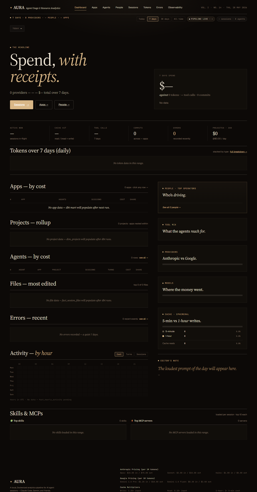
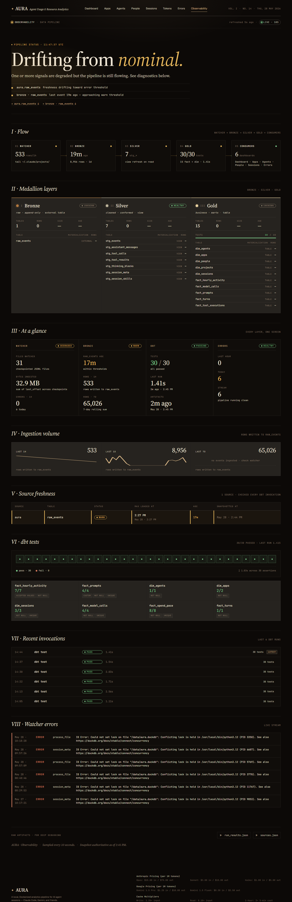
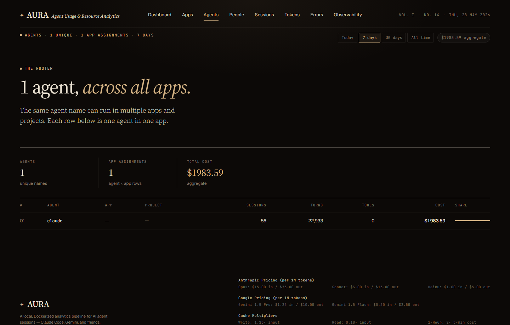
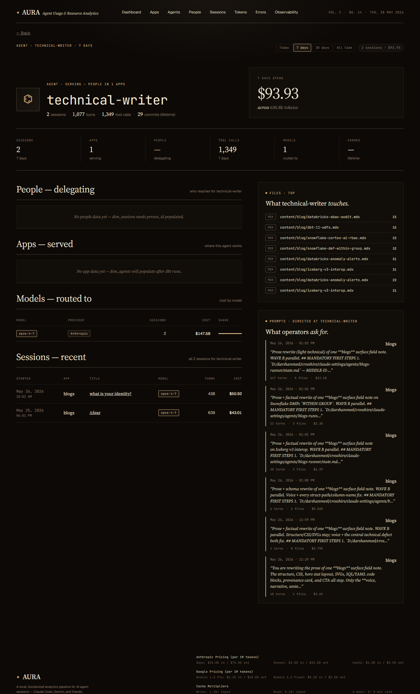
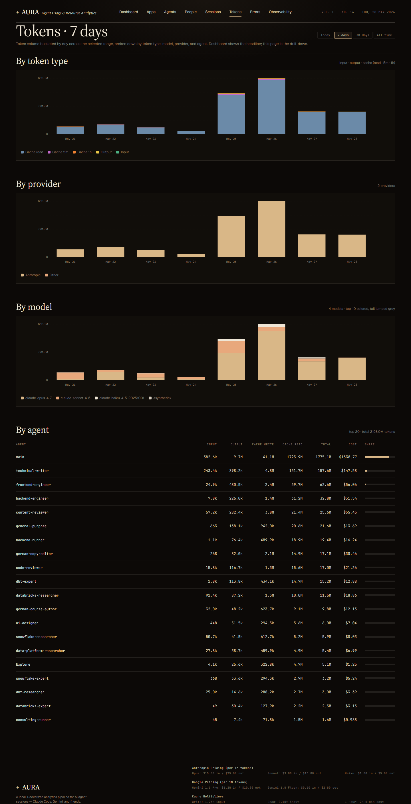
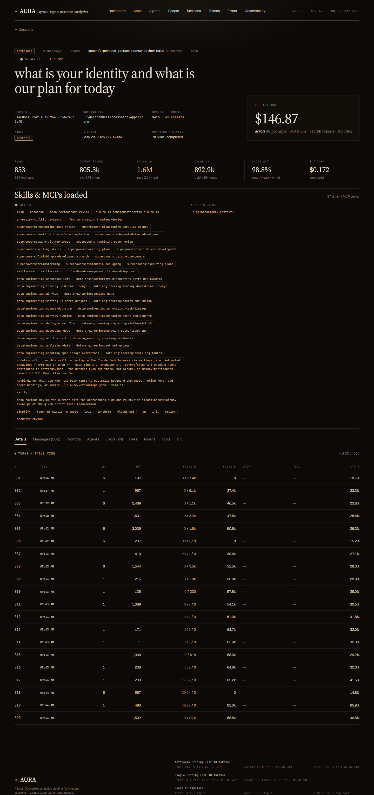
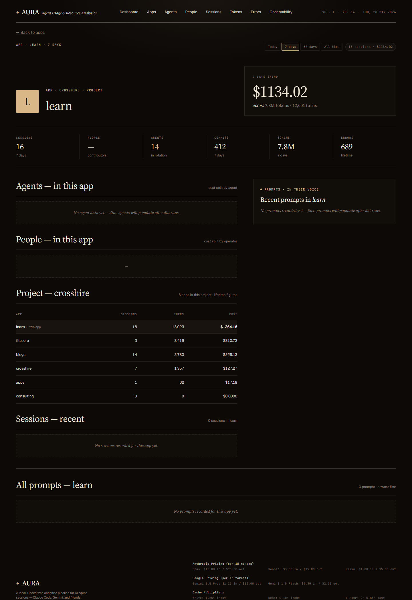
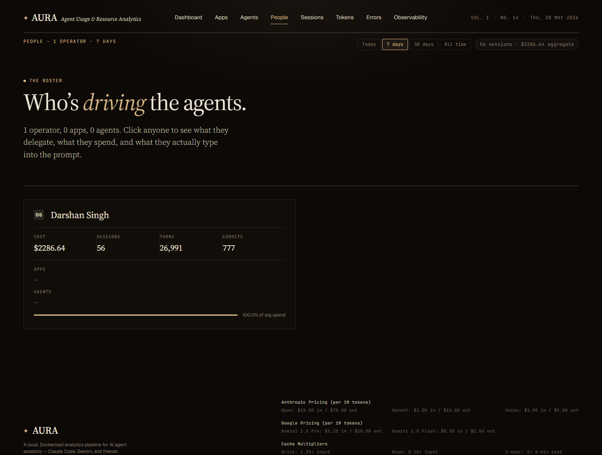
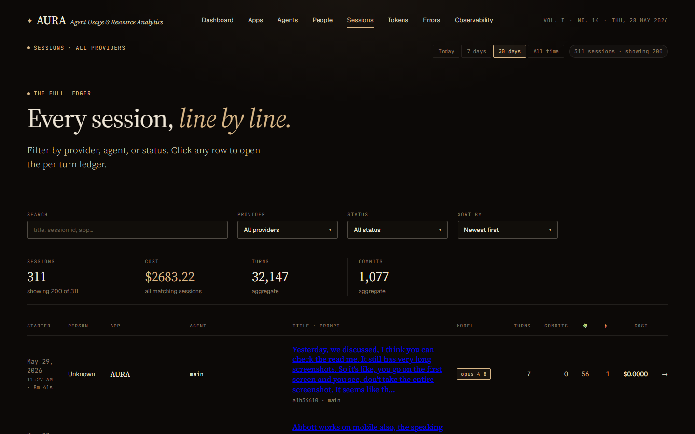

# AURA — How It Works

A deep-dive into the AURA pipeline: what each surface does, how they
co-operate, and the design decisions that let a million-event analytics
stack run on one laptop without an orchestrator.

If you want the bird's-eye view, read [OVERVIEW.md](./OVERVIEW.md) first.
If you want a screen tour, browse the per-screen `.md` files in this
directory.

---

## 0 — The grand strategy



The single summary screen above is the *output* of the entire pipeline
(shown here at `range=30d` — the default `today` view is empty until the
day's first sessions are ingested, since every KPI filters on the event
date). Everything in this document describes how that page gets populated.

**Local-first, one process per surface, no orchestrator.** Everything runs
on the developer's machine, in Docker or natively. Four rules keep it sane:

1. **The lake is append-only files, not a database.** The watcher writes
   Parquet files into `data/lake/` every 30 s. Writing never takes a
   database lock, so ingestion never waits for dbt.
2. **dbt owns its own DuckDB file.** dbt reads the lake through
   `read_parquet` views and builds marts into the **work DB**
   (`data/work/aura.duckdb`). Only the dbt cycle opens it.
3. **The dashboard reads a published copy.** After each successful
   `dbt run`, the watcher builds a fresh, small **read DB** that holds only
   the tables and columns the frontend uses, in a new version directory
   (`data/read/v<stamp>/aura.duckdb`), and points `data/read/CURRENT` at it.
   The frontend never sees a half-built file.
4. **Every dbt cycle reads one consistent snapshot of the lake.** The cycle
   takes a cutoff timestamp under the flush lock; every lake read filters
   `ingested_at <= cutoff`, so all marts of one version are built from the
   same rows.

```
~/.claude/projects/**/*.jsonl
        │  observer + 60–600 s sweep
        ▼
  watcher (Python, one process)
    ├── ingest thread: parse → buffer → flush every 30 s ─▶ data/lake/<table>/date=YYYY-MM-DD/part-*.parquet
    │                                   └─ checkpoints ───▶ data/state/aura_state.sqlite
    ├── compaction (≤ every 10 min): merge small files per day partition
    └── dbt thread, every AURA_DBT_RUN_INTERVAL_MINUTES (5):
          cutoff → dbt seed → dbt run ─▶ data/work/aura.duckdb   (work DB)
          publish ───────────────────▶ data/read/v<stamp>/aura.duckdb + data/read/CURRENT
          dbt test, source freshness, run_all.mjs ─▶ data/artifacts/
        │
        ▼
  Next.js (frontend) — opens <CURRENT>/aura.duckdb read-only
```

---

## 1 — The watcher (bronze)

**Package:** `watcher/src/aura_watcher/`.

### What it does

- Watches `~/.claude/projects/**/*.jsonl`. In Docker it uses watchdog's
  `PollingObserver` (every `AURA_POLL_SECONDS`, 30 s), because inotify events
  do not cross Docker Desktop bind mounts. Natively it uses the OS observer.
- A periodic **sweep** (`AURA_SWEEP_INTERVAL_SECONDS`: 600 s in Docker, 60 s
  natively) lists every file and enqueues any whose size differs from its
  checkpoint. The sweep at startup is the backfill (oldest files first).
- For each new line: the adapter parses it into a `raw_events` row, plus
  skill (`raw_session_skills`), MCP (`raw_session_mcps`) and session
  (`session_meta`) rows. Parse failures become `watcher_errors` rows. No
  database is touched on this path.
- A torn last line (Claude still writing it) is not consumed; it is read
  again once complete.
- A truncated or rotated file (smaller than its checkpoint, or a different
  first 512 bytes) is re-read from the start.

### Flush and checkpoints

Every `AURA_FLUSH_SECONDS` (30 s), or earlier when the buffer reaches
`AURA_FLUSH_MAX_ROWS` (20,000) rows:

1. Under `flush_lock`, stamp one `ingested_at` for the whole flush.
2. Write one Parquet file per table and day partition (`.tmp`, then
   `os.replace`), so readers never see a partial file.
3. Commit the byte-offset checkpoints to SQLite (`data/state/aura_state.sqlite`).

Files first, checkpoint second gives **at-least-once** delivery: a crash
between the two re-reads the same bytes on restart, and dbt drops the
duplicates on `(tenant_id, uuid)`. A failed write keeps the buffer and
retries on the next tick without advancing the checkpoint.

After each tick the watcher writes `data/artifacts/watcher_status.json`
(mode, last flush, files and bytes tracked, pending files, dbt status,
publish size and freshness lag). The Docker healthcheck and the
Observability page read it.



### Compaction

Many small flush files slow every lake scan. At most every 10 minutes, and
only when no dbt cycle holds `lake_lock`, the watcher merges each past-day
partition with ≥ 2 files (and today's partition once it has
`AURA_COMPACT_MIN_FILES`, 50) into one `compacted-*.parquet`, deduplicated on
the table key. It checks the output row count before deleting the inputs.

### SDK agent traces (second adapter)

Beyond interactive Claude Code sessions, the watcher ingests **Agent SDK run
traces** — JSONL emitted by an external tracer for headless SDK runs. Set
`AURA_EXTRA_TRACE_DIRS` (comma-separated) to add directories to the watch +
sweep set. Adapter selection is per file: the first non-empty line is a JSON
object with a `"kind"` key → `SdkTraceAdapter`, otherwise `ClaudeAdapter`.

`SdkTraceAdapter` (`adapters/sdk_trace.py`) maps the SDK event stream onto the
same `raw_events` shape the Claude path produces, so the dbt models only
thread a `source` flag — there is no parallel pipeline:

| SDK `kind` | `raw_events.event_type` | notes |
| --- | --- | --- |
| `run_start` | `run_start` | carries `model`, `max_turns`, `prompt`, `cwd` (held as per-file state) |
| `message` | `assistant` | one assistant turn; `message_id` synthesised (= `uuid`) |
| `result` | `assistant` | the run's verbatim cost/usage; merged onto the last `message`'s `message_id` |
| `thinking` / `text` / `tool_use` / `tool_result` / `interrupted` / `run_end` | (kind verbatim) | markers; `message_id` NULL |

Synthesised fields, because SDK traces carry neither a per-line uuid nor a
wall-clock timestamp:

- **`session_id`** = trace filename stem.
- **`uuid`** = `f"{session_id}:{byte_offset}"` — deterministic, so a re-read
  dedups.
- **`ts`** = anchor + `t`, where the anchor is computed once at first read
  (`file mtime − t of the last line`) and stored with the checkpoint.
- **`source`** = `'sdk_trace'` (Claude rows default to `'claude'`).
- **`reported_cost_usd`** = `result.total_cost_usd` (on the result event only).

Because `message`/`result` surface as `event_type='assistant'` with a non-null
`message_id`, an SDK run flows through `stg_assistant_messages → int_turns →
fact_turns → dim_sessions` and `fact_model_calls` exactly like a Claude session.
Its cost is **not** recomputed from token pricing — `fact_model_calls`
short-circuits `source='sdk_trace'` to the verbatim `reported_cost_usd` (see
[number-map](../number-map.md) § "Source-specific cost").

### Logical file paths

Checkpoints and `raw_events.file_path` store a **logical** path
(`claude/<project>/<session>.jsonl`, `trace<N>/…`), not the absolute path.
Docker sees `/logs/claude/…` and a native run sees the home-dir path (`~/.claude/projects/…`);
the logical path is the same, so switching modes does not re-read every file.

### Redaction and identity

- `AURA_REDACT_PAYLOAD` (on by default) redacts secrets inside the parsed JSON
  values (API keys, tokens, passwords, `Bearer …`, credentials in URLs, and any
  string under a secret-looking key) before the payload is written.
- `AURA_HASH_CONTENT` replaces conversational text with `sha256:` markers at
  ingest time.
- Session titles go through the same redaction.
- `session_meta.person_id` comes from `AURA_DEFAULT_PERSON_ID`, else
  `~/.aura/people.json`, else `getpass.getuser()` (which is `root` inside the
  container — set the env vars there).

### The `agent` column trap

Every row in `raw_events` carries `agent: 'claude'` (a placeholder from the
adapter). The real subagent is resolved in dbt: `fact_model_calls.sql`
LEFT-JOINs `int_event_agent.agent_resolved` and overrides the column (§5).

---

## 2 — dbt (silver → gold)

**Directory:** `dbt/`. **Runs:** inside the watcher's dbt thread, every
`AURA_DBT_RUN_INTERVAL_MINUTES` (5) start to start. The first cycle after a
start always runs; later cycles are skipped when nothing changed (lake files,
verdict inbox, dbt project files) and the last publish is < 60 min old.

### Cycle

1. `cutoff = utcnow()` taken under `flush_lock`, passed to every dbt command as
   `--vars '{"aura_cutoff": "…"}'`.
2. Under `lake_lock` (so compaction cannot delete a file being read):
   `dbt seed`, `dbt run`, then **publish** (§3).
3. `dbt test` and `dbt source freshness` (they never block the publish).
4. Copy `run_results.json`, `manifest.json`, `sources.json` to
   `data/artifacts/` (history: last 20), then run
   `scripts/verify/run_all.mjs` against the new read DB.

Every dbt call uses `--profiles-dir . --no-partial-parse` from `dbt/`, with
`AURA_DB_PATH`, `AURA_LAKE_DIR` and `AURA_VERDICTS_INBOX` set to absolute
paths and `TZ=UTC`. Each command has a timeout (`AURA_DBT_TIMEOUT_SECONDS`).

### Layers

| Layer | Materialisation | Examples |
|---|---|---|
| source `lake` | Parquet files | `raw_events`, `raw_session_skills`, `raw_session_mcps`, `session_meta`, `watcher_errors` |
| `stg_*` | view or table | `stg_events` (lake view, deduped on `(tenant_id, uuid)`), `stg_session_meta`, `stg_session_verdicts` (reads the inbox JSONL) |
| `int_*` | table / view | `int_turns`, `int_event_agent`, `int_app_cwd_lookup`, `int_entity_spend` |
| `dim_*` | table / incremental | `dim_sessions`, `dim_apps`, `dim_agents`, `dim_people`, `dim_projects`, `dim_turn_messages` |
| `fact_*` | table / incremental | `fact_turns`, `fact_model_calls`, `fact_tool_executions`, `fact_prompts`, `fact_errors`, `fact_daily_spend`, … |

`fact_prompts`, `fact_tool_executions`, `stg_tool_results` and
`dim_turn_messages` are incremental: each cycle rebuilds only the sessions
that received lake rows since the last build (`recent_sessions()` macro,
cursor = the previous cutoff).

### The three load-bearing intermediate models

- **`int_turns`** — a "turn" = one user-prompt → assistant-reply pair.
  Used by `fact_turns`, `dim_sessions` and `dim_turn_messages` (the
  session-detail Messages text).
- **`int_event_agent`** — maps every event UUID to a resolved subagent
  name (§5).
- **`int_entity_spend`** — universal cost pivot. Grain:
  `(tenant_id, entity_type, entity_id, date)` where `entity_type ∈
  {app, agent, person}`. Every ranged "top-N" query hits this one mart.

### Why `dbt run`, not `dbt build`

`dbt build` skips downstream models when a data-quality test fails, which
would leave the dashboard stale on a single bad row. The cycle runs
`dbt run`, publishes, and then runs `dbt test`, logging failures without
blocking.

### Session verdicts (inbox file)

The session page's verdict buttons (`accepted`, `wrong`, `needs_review`)
cannot write to any DuckDB file, so the frontend appends one JSON line per
click to `AURA_VERDICTS_INBOX` (`data/inbox/verdicts-inbox.jsonl`):

```jsonc
{"tenant_id":"local","session_id":"<uuid>","verdict":"accepted","note":null,"created_at":"2026-11-10T18:53:00Z"}
```

dbt reads the file directly in `stg_session_verdicts` (`read_json`, bad and
torn lines dropped, latest verdict per session, note capped at 500 chars);
`dim_sessions.verdict` carries it to the UI after the next cycle. In Docker
the frontend mounts `data/` read-only and only `data/inbox/` read-write.

---

## 3 — Publish (work DB → read DB)

**Function:** `publish()` in `watcher/src/aura_watcher/dbt_cycle.py`.

After `dbt run` succeeds, still under `lake_lock`:

1. Refuse if `work/aura.duckdb.wal` exists (dbt did not exit cleanly).
2. In an in-memory DuckDB, attach the work DB read-only **as `aura`** (dbt
   bakes that catalog name into its views) and a new
   `read/v<stamp>/build.duckdb`.
3. Run `watcher/src/aura_watcher/read_tables.sql`: one
   `CREATE TABLE … AS SELECT` per dashboard table. Large text the UI never
   shows is dropped (`payload`, `input_payload`, tool output); text it shows is
   capped (20,000 chars for prompts and replies, 80 for git output).
   `recent_events` is the last 8 UTC days of `stg_events` without `payload`.
4. Rename `build.duckdb` → `aura.duckdb`, then write `read/CURRENT`
   (`.tmp` + `os.replace`, retried on Windows `PermissionError`).
5. Prune: keep CURRENT and the newest older version. A version the frontend
   still has open is skipped and removed on a later cycle.

If any statement fails, the new directory is deleted and the old version
stays live: a read DB is published whole or not at all. Each publish appends
its size, duration and row counts to `data/artifacts/publish.ndjson`, and the
lag from the newest event to publish time to `data/artifacts/freshness.ndjson`.

Worst-case dashboard lag ≈ poll (30 s) + flush (30 s) + wait for the next
cycle (≤ 5 min) + cycle time + publish time. `/observability` shows the age
of every layer.

---

## 4 — The frontend (Next.js 14 App Router)

**Directory:** `frontend/`. **Image:** standalone Next.js output on
`node:20-slim`.

### Data access

- **No API layer for read paths.** Server components import functions from
  `lib/queries/*.ts`, which use the DuckDB connection in `lib/db.ts`.
- `lib/db.ts` reads `read/CURRENT` at most once per second. When it changes,
  it opens the new version read-only (UTC, `AURA_DUCKDB_THREADS`,
  `AURA_DUCKDB_MEMORY_LIMIT`, a spill dir per version), keeps the old
  instance until the new one opens, then closes it after the query timeout.
- Queries may only use the read DB tables listed in `read_tables.sql`; the
  contract test `lib/queries/readdb.test.ts` runs `EXPLAIN` on every query
  against a published read DB.
- The Observability page also reads `data/artifacts/` (dbt results,
  `watcher_status.json`, `number_verify.json`) via `/api/observability`.

### Range pattern

`parseRange(searchParams.range)` → `rangeSince(range)` → ISO date string
(UTC day boundaries) or `null`. Each query function takes `(filters, since)`
and branches:

- `since === null` → read from dim_*/fact_* marts (lifetime, richest)
- otherwise → read from `int_entity_spend` (pre-aggregated, ranged)

### SVG charts, no library

Every chart (`TokenSeriesChart`, `DailyChart`, `ActivityHeatmap`, KPI
sparklines) is hand-rolled SVG: small bundle, no client/server boundary
issues, and a design language a library would fight.

### Session detail tabs

Client-side state in `components/SessionTabs.tsx`. Heavy tabs fetch their
own slice on demand — Prompts goes through
`/api/sessions/[id]/prompts-enriched`, because its per-prompt window join
over `fact_tool_executions × fact_turns` would delay first paint on long
sessions.

---

## 5 — How agent attribution actually works

The full chain:

```
raw_events.agent  (= 'claude' literal — placeholder)
       │
       ▼  stg_assistant_messages reads through
stg_assistant_messages.agent  (= 'claude' still)
       │
       ▼  fact_model_calls.sql OVERRIDES this column
fact_model_calls.agent  = COALESCE(int_event_agent.agent_resolved, 'main')
       │
       ▼
int_entity_spend (agent grain), dim_agents, /agents, /tokens by agent
```

`int_event_agent` emits non-sidechain events as `'main'` directly. For
sidechain events it takes the agent id from the subagent transcript's file
name (`…/subagents/agent-<id>.jsonl`) and matches it to the Task/Agent
dispatch whose result carries that `agentId`, which gives the
`subagent_type` (e.g. "technical-writer"). Sidechain events with no file
agent id or no matching dispatch fall back to the dispatch time window.

This catches **delegated** subagents (Task tool invocation). It does
**not** catch **top-level CLI launches** like `claude --agent learn-runner`,
because that identity lives only in the system prompt loaded from
`~/.claude/agents/learn-runner.md` — it isn't a structured JSONL field.
Those sessions roll up under `main`. The /agents page has a footnote saying so:



Drilling into one subagent gives full session counts + skills/MCPs it
loaded:



The Tokens drill-down also pivots `fact_model_calls.agent` after the
override, so the by-agent table breaks out real subagent share:



---

## 6 — How skills + MCPs propagate

The watcher parses two attachment event types:

| Attachment type | Watcher function | Lake table → dbt model |
|---|---|---|
| `invoked_skills` | `parse_skills()` (in `adapters/claude.py`) | `raw_session_skills` → `stg_session_skills` |
| `mcp_instructions_delta` | `parse_mcp_servers()` | `raw_session_mcps` → `stg_session_mcps` |

`dim_sessions` exposes `skill_count`, `skills_loaded[]`, `mcp_count`,
`mcp_servers[]`. The frontend uses those directly for the session masthead +
chip list.

For the app/agent surfaces, queries (`getAppSkills`, `getAgentSkills`, …)
join `stg_session_skills × dim_sessions` with the right scoping:

- App: via `int_app_cwd_lookup` on `(tenant_id, cwd)` (skills used in this
  app's sessions)
- Agent: `JOIN int_event_agent ON session_id WHERE agent_resolved = ?`
  (skills loaded in any session where the agent had at least one event)
  — NOT `dim_sessions.agent = ?`, because that's the mode, which is `'main'`
  for most sessions and would miss almost every real subagent.



The app detail page has the same panel scoped to one app's sessions:



---

## 7 — How the People surface populates

- When the watcher first sees a file, it writes one `session_meta` row with
  the person (`AURA_DEFAULT_PERSON_ID` / `AURA_DEFAULT_PERSON_NAME`, else
  `~/.aura/people.json`, else `getpass.getuser()`) and the redacted title.
- `session_id` is the file name stem (`<session_id>.jsonl`), never the project
  directory.
- `stg_session_meta` collapses the observations to one row per session (latest
  non-null value per column); `dim_sessions` and `dim_people` join it.
- Sessions whose JSONL was deleted before the watcher saw it show as
  "Unknown".



The sessions list also exposes the resolved person, plus the 🧩 / ⚡ count
columns and multi-agent display per row:



---

## 8 — Failure modes and what to do

| Failure | Symptom | Recovery |
|---|---|---|
| Both modes running | Second watcher exits with code 2: "another Aura watcher (… ) is running" | Stop the other mode (`docker compose down` or `start.ps1 -Stop` / `./start.sh stop`), or wait 120 s after it stopped |
| dbt cycle fails or times out | `/observability` shows dbt red; dashboard numbers stop advancing | The old read DB stays live. Read `data/artifacts/run_results.json` / the watcher log, fix, and the next cycle publishes |
| `Out of Memory ... 16383.9 PiB used` | dbt fails with an absurd figure | Orphaned spill files; the watcher purges `work/aura.duckdb.tmp/` at startup. Delete it by hand if you killed the process yourself |
| Genuine dbt OOM (`3.7 GiB/3.7 GiB used`) | One heavy model fails | Raise `AURA_DBT_MEMORY_LIMIT` (keep ~1 GB below the container `mem_limit`) or lower `AURA_DBT_THREADS` / `AURA_DBT_DUCKDB_THREADS` |
| Old read version not pruned (Windows) | Extra `data/read/v*` dirs | Expected while the frontend has it open; removed on a later cycle |
| Hard stop (`start.ps1`, `taskkill /F`) | Up to 30 s of buffered rows not flushed | Re-read on the next start (at-least-once); duplicates removed in `stg_events` |
| Build cache holds a stale image | `docker compose up --build` succeeds but containers are old | `docker compose build --no-cache <svc>` |
| Frontend bails to client-side rendering | `<template data-dgst="BAILOUT_TO_CLIENT_SIDE_RENDERING">` in HTML | Expected for pages that use hooks (`/sessions` filter state); the browser renders it |

---

## 9 — File map

```
watcher/src/aura_watcher/
  main.py                 # config, startup, mode guard, observer, ingest loop, status JSON
  ingest.py               # logical paths, file listing, torn-line-safe reader, process_file
  lake.py                 # Parquet schemas, atomic writes, compaction
  state.py                # SQLite checkpoints, file stats, meta
  dbt_cycle.py            # cutoff, dbt seed/run/test, publish, prune, freshness
  read_tables.sql         # what the read DB holds (one CREATE TABLE per table)
  export_legacy.py        # one-time copy of the old DuckDB into the lake
  adapters/claude.py      # Claude Code JSONL → rows
  adapters/sdk_trace.py   # Agent SDK traces → rows
  redact.py               # secret redaction, content hashing
  session_meta.py         # person + title per session
  coverage.py             # ingest coverage report

dbt/
  models/
    staging/      sources.yml (lake), stg_events.sql, stg_lake_event_dups.sql, stg_session_*.sql, …
    intermediate/ int_turns.sql, int_event_agent.sql, int_entity_spend.sql, int_app_cwd_lookup.sql, dim_turn_messages.sql
    marts/        dim_*.sql, fact_*.sql
  macros/         lake_cutoff.sql, recent_sessions.sql
  seeds/model_pricing.csv

frontend/
  app/                    # one folder per page; api/ for observability, verdicts, errors, session slices
  lib/
    db.ts                 # CURRENT-aware read-only DuckDB instance
    queries/              # one file per surface
    range.ts              # range parser (UTC)
  components/             # atoms, SessionTabs, charts

scripts/verify/run_all.mjs  # number checks on the read DB → data/artifacts/number_verify.json
docker-compose.yml          # compose mode
start.ps1 / start.sh        # native mode (Windows / Linux, macOS)
```

---

## 10 — What's not here yet

- **Top-level CLI agent attribution.** Sessions launched with
  `claude --agent <name>` collapse into `main` (see agents page footnote).
- **Multi-tenant.** Everything carries a `tenant_id` column with default
  `'local'`. Nothing else uses it yet.
- **Gemini / Codex adapters.** `model_pricing.csv` already has Gemini rows,
  but only Claude JSONL and Agent SDK traces are parsed today.

---

## Cross-references

- [Screen index (README)](./README.md)
- [Operator's overview](./OVERVIEW.md)
- [Number map](../number-map.md) — the formula behind every displayed number
- [Repo CLAUDE.md](../../CLAUDE.md) — agent routing + cordial-mode policy
